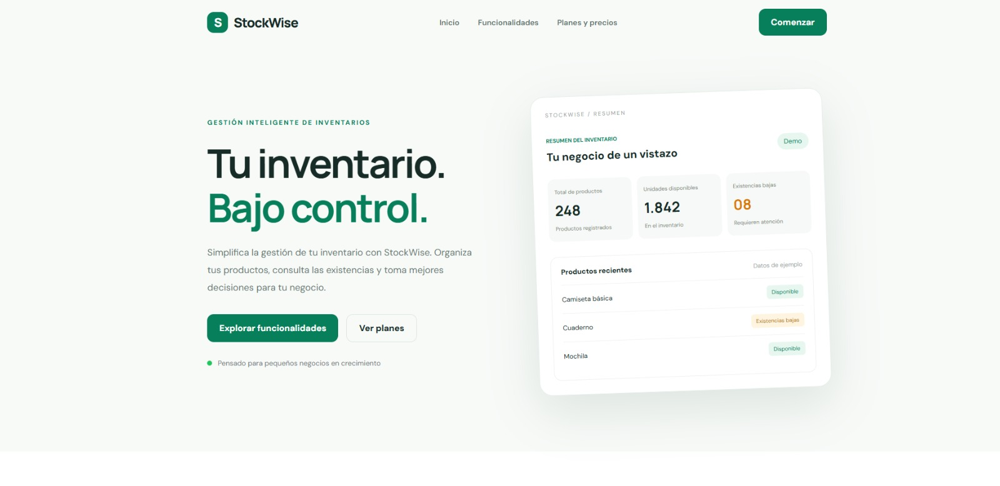
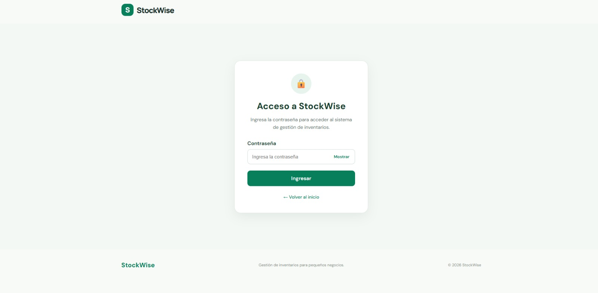
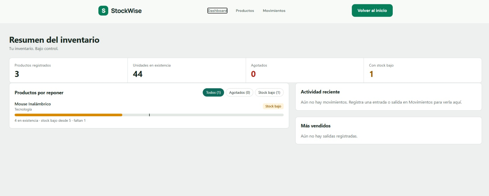
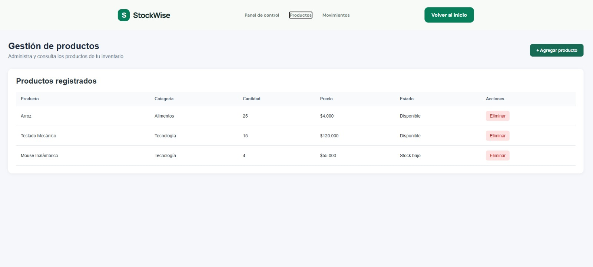
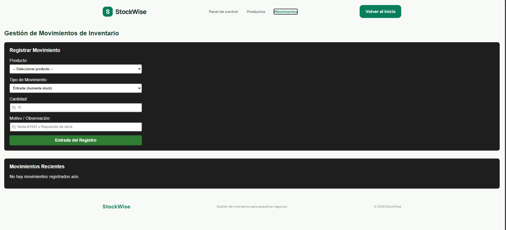

# StockWise — Gestión Inteligente de Inventarios

**StockWise** es una aplicación web desarrollada en React diseñada para facilitar el control y la administración de inventarios en pequeños negocios. Permite gestionar el catálogo de productos, registrar entradas y salidas de mercancía con validación de existencias y monitorear alertas de reposición en tiempo real.

---

## Módulos y Funcionalidades

1. **Inicio y Navegación (`App.js`):** Interfaz principal de presentación de la plataforma y navegación dinámica entre vistas sin recarga de página.
2. **Gestión de Productos (`Products`):** Formulario de registro y listado general con cálculo automático del estado de existencias (`Disponible`, `Stock bajo` y `Agotado`).
3. **Movimientos de Inventario (`MovimientosInventario`):** Registro de **Entradas** y **Salidas** de inventario con validación de stock disponible, actualización automática de cantidades e historial de movimientos con fecha y motivo.
4. **Dashboard y Alertas (`Dashboard`):** Panel de resumen con indicadores generales del negocio y alertas tempranas para productos agotados o con pocas unidades.

---

## Arquitectura y Buenas Prácticas Aplicadas

* **Estado Centralizado (*Lifting State Up*):** El estado compartido de `products` y `movimientos` se gestiona en `src/App.js` y se distribuye mediante *props*, garantizando sincronización inmediata entre módulos.
* **Estructura Modular:** Organización del código fuente separada por responsabilidades en `src/Pages/`, `src/Components/`, `src/Styles/` y `src/Utils/`.
* **Flujo de Trabajo Colaborativo en Git:** Desarrollo aislado por ramas de funcionalidad (`ftInventory`, `feature/*`), sincronización constante con la rama `prod` e integración mediante *Pull Requests* con revisión de código (*Code Review*) y mensajes bajo el estándar *Conventional Commits*.

---

## Tecnologías Utilizadas

* **Frontend:** React 19, JavaScript (ES6+), HTML5, CSS3
* **Herramientas de compilación:** Create React App (`react-scripts` 5.0.1)
* **Pruebas:** React Testing Library, Jest DOM y User Event
* **Entorno de ejecución:** Node.js 18 o superior y npm
* **Control de versiones:** Git y GitHub
* **Despliegue:** Vercel

---
## Instalación y Ejecución Local

### Requisitos previos
* [Node.js](https://nodejs.org) 18 o superior (versión LTS)
* npm (incluido con Node.js)
* [Git](https://git-scm.com)

### Pasos
1. Clona el repositorio:
   ```bash
   git clone https://github.com/JnrMls/Proyecto-Saas.git
   cd Proyecto-Saas
   ```
2. Instala las dependencias:
   ```bash
   npm install
   ```
3. Inicia el servidor de desarrollo:
   ```bash
   npm start
   ```
4. Abre [http://localhost:3000](http://localhost:3000) en el navegador. La página se recarga sola al guardar cambios.

### Comandos disponibles

| Comando | Descripción |
|---|---|
| `npm start` | Inicia el servidor de desarrollo en `http://localhost:3000`. |
| `npm run build` | Compila la aplicación para producción en la carpeta `build/`. |
| `npm test` | Ejecuta las pruebas en modo interactivo. |
| `npm run eject` | Expone la configuración de Create React App (acción irreversible). |

---

## Estructura del Proyecto

```
Proyecto-Saas/
├── public/                  # Archivos estáticos (index.html, favicon, íconos)
├── src/
│   ├── Components/
│   │   └── Products/        # Componentes reutilizables del módulo de productos
│   ├── Pages/
│   │   ├── Dashboard.js             # Panel de resumen y alertas
│   │   ├── MovimientosInventario.js # Registro de entradas y salidas
│   │   ├── PasswordAccess.js        # Pantalla de acceso con contraseña
│   │   └── Products.js              # Gestión y listado de productos
│   ├── Styles/              # Hojas de estilo de cada página
│   ├── Utils/
│   │   └── inventario.js    # Lógica de inventario (con sus pruebas)
│   ├── App.js               # Componente principal y navegación
│   ├── index.js             # Punto de entrada de la aplicación
│   └── setupTests.js        # Configuración de las pruebas
├── package.json             # Dependencias y scripts del proyecto
└── README.md                # Documentación del proyecto
```
---

## Acceso a la Aplicación

Para ingresar a StockWise en [stockwise.tech](https://stockwise.tech), utiliza la siguiente contraseña de demostración:

| Dato | Valor |
| --- | --- |
| Contraseña | `stockwise2026` |

> Esta clave es solo para fines académicos y de demostración.
## Dominio Público

La aplicación está disponible en: [https://stockwise.tech](https://stockwise.tech)

---

## Recursos Adicionales

* [Documentación de React](https://react.dev)
* [Documentación de Create React App](https://create-react-app.dev)
* [Documentación de Node.js](https://nodejs.org/docs)
* [Guía de Git](https://git-scm.com/doc)

---

## Solución de Errores Comunes

| Problema | Solución |
|---|---|
| `npm: command not found` | Instala Node.js (versión LTS) desde nodejs.org y reinicia la terminal. |
| `npm install` falla o muestra errores de dependencias | Borra la carpeta `node_modules` y el archivo `package-lock.json`, y ejecuta `npm install` de nuevo. |
| El puerto 3000 está ocupado | Cierra el otro proceso o acepta que React use otro puerto cuando lo pregunte. |
| La página sale en blanco | Revisa la consola del navegador (F12) y confirma que ejecutaste `npm install` antes de `npm start`. |

---

## Flujo de Funcionamiento

1. **Inicio:** el usuario llega a la página principal y pulsa **Comenzar**.
2. **Acceso:** ingresa la contraseña para entrar al sistema de inventario.
3. **Dashboard:** ve el resumen del negocio (total de productos, unidades, agotados y stock bajo) y las alertas de reposición.
4. **Productos:** registra nuevos productos (con validación de datos) y consulta el listado.
5. **Movimientos:** registra entradas y salidas de inventario; no permite sacar más unidades de las disponibles.

## Capturas de la Aplicación

### Inicio


### Acceso


### Dashboard


### Productos


### Movimientos
